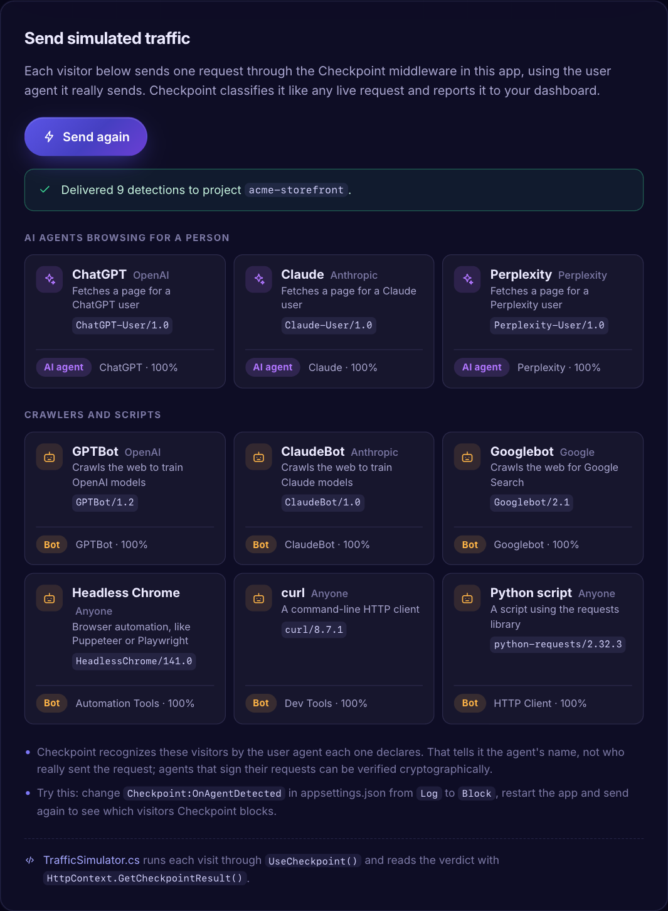
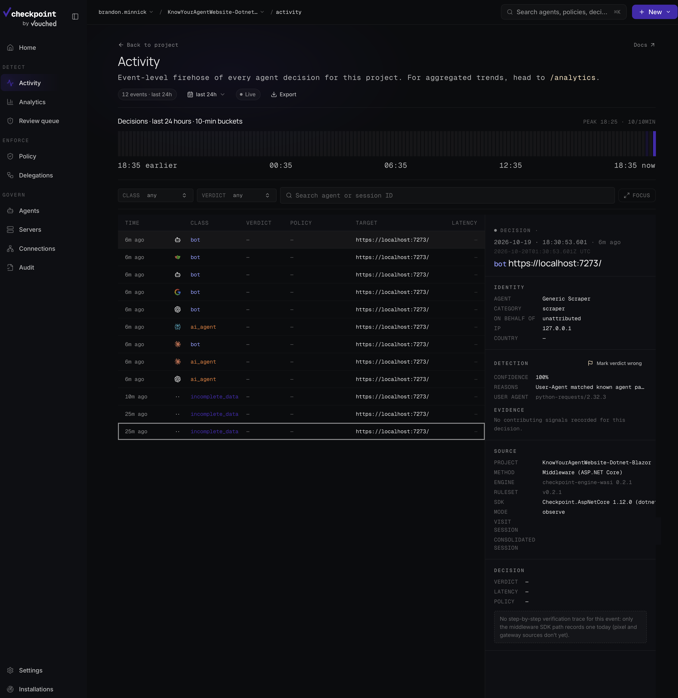

# Know Your Agent: a Checkpoint by Vouched sample for ASP.NET Core

[](https://github.com/TheCodeTraveler/KnowYourAgentWebsite-Dotnet-Blazor/actions/workflows/build.yml)
[](LICENSE)
[](https://dotnet.microsoft.com/download/dotnet/10.0)
[](https://www.nuget.org/packages/KyaOs.Checkpoint)

A small ASP.NET Core app that shows how to add [Checkpoint by Vouched](https://kya.vouched.id/docs/integrations/dotnet) to a .NET website. Run it, connect your Vouched project, send it simulated AI agent and bot traffic, and watch every visit arrive in your Checkpoint dashboard.



## Get your Project ID and API key

You need a free Vouched account and a Checkpoint project. Detect is free, so there's no credit card to enter.

### 1. Create a project

1. Sign up at [kya.vouched.id/signup](https://kya.vouched.id/signup), or [sign in](https://kya.vouched.id/signin) if you already have an account. The first time you sign in, you're asked to create an organization.
2. Click **New** in the top navigation, then **New project**.
3. Enter a **Project Name**, like `Know Your Agent sample`, and the **Site URL** of the website you'll protect, like `https://example.com`. This sample still runs on `localhost`.
4. Click **Add Domain**. The project is created right away, and the dialog shows its installation steps.

### 2. Copy your Project ID

Open **Installations** in the project's left rail and start the Detect setup with **Configure & install**. Every install snippet includes your Project ID: in the ASP.NET Core snippet it's the value of `options.ProjectId`, and in the pixel snippet it's `data-project-id`. The ID is all you need from the snippet, because this sample already contains the rest.

### 3. Create an API key (optional)

[Install the `kya-os` CLI](https://kya.vouched.id/docs/installation). Use the following commands to create your API key and save it, along with your Project ID, to this app's user secrets. Skip the `Program.cs` lines the CLI prints; [`WebsiteApplication.cs`](src/KnowYourAgentWebsite/WebsiteApplication.cs) already has them.

```bash
cd src/KnowYourAgentWebsite
kya-os login
kya-os detect install --surface sdk --project <your project id>
```

Once these commands are run, the API Key will be automatically added to the Blazor app. You can then retrieve the Project ID and API Key by running the following command:

```bash
dotnet user-secrets list
```

The API key is optional:

| You add | What shows up in your dashboard |
| --- | --- |
| Project ID | Your visits to this sample, reported by the Checkpoint pixel in your browser |
| Project ID and API key | Your visits, plus everything the Checkpoint middleware detects, including the simulated traffic |

## Run it

You need the [.NET 10 SDK](https://dotnet.microsoft.com/download/dotnet/10.0) and a trusted development certificate (`dotnet dev-certs https --trust`).

```bash
git clone https://github.com/TheCodeTraveler/KnowYourAgentWebsite-Dotnet-Blazor.git
cd KnowYourAgentWebsite-Dotnet-Blazor
dotnet run --project src/KnowYourAgentWebsite
```

Open **https://localhost:7273** and follow the three steps on the page:

1. **Connect your Vouched project.** Paste your Project ID, and your API key if you have it. The app saves them to your [.NET user secrets](https://learn.microsoft.com/aspnet/core/security/app-secrets) and restarts itself to apply them.
2. **Send simulated traffic.** This step requires an API key. One button sends a request from ChatGPT, Claude, Perplexity, GPTBot, ClaudeBot, Googlebot, Headless Chrome, curl and a Python script through the Checkpoint middleware, shows how Checkpoint classified each one, and reports every visit to your dashboard.
3. **Watch it arrive in your dashboard.** Open [your dashboard](https://kya.vouched.id/dashboard), switch to the project you connected, and go to **Detect → Activity**. With an API key, each simulated visit appears with its class, confidence and agent name, usually within a minute. With only a Project ID, look for your own visit, reported by the pixel.




> [!NOTE]
> Saving keys and sending traffic only work when the app runs in the `Development` environment and you browse it from the same machine. A deployed copy never exposes them, and they refuse requests from dev tunnels and reverse proxies that add forwarding headers. Like any app running in `Development`, don't expose it to the internet.

Prefer the command line? These write to the same user-secrets file. The second one is optional:

```bash
dotnet user-secrets set "Checkpoint:ProjectId" "<your project id>" --project src/KnowYourAgentWebsite
dotnet user-secrets set "Checkpoint:ApiKey" "<your api key>" --project src/KnowYourAgentWebsite
```

### Not seeing traffic in your dashboard?

- **Check the project.** The dashboard shows one project at a time, and the app sends everything to the Project ID in step 1. You'll find each project's ID under **Installations**.
- **Check Activity's filters.** Widen the time range and clear any filters. Your own visit is classified as human.
- **Add an API key for the simulated traffic.** With only a Project ID, the dashboard shows the visits the pixel reports from your browser, not the simulated traffic.
- **Check the pixel.** Browser extensions that block trackers can block `kya.vouched.id/pixel.js`. Set `CheckpointPixel:Debug` to `true` in `appsettings.json` and the pixel logs every report it sends to your browser's console.

## How it works

Checkpoint is ASP.NET Core middleware from the [`KyaOs.Checkpoint`](https://www.nuget.org/packages/KyaOs.Checkpoint) NuGet package. It classifies every request as a human, an AI agent or a bot, adds `KYA-*` headers describing the verdict, and reports agents and bots to your dashboard.

| File | What to look at |
| --- | --- |
| [`WebsiteApplication.cs`](src/KnowYourAgentWebsite/WebsiteApplication.cs) | `AddCheckpoint()` binds the `Checkpoint` configuration section, and `UseCheckpoint()` runs before routing so every request is classified. Without an API key, the middleware stays in local detection-only mode instead of sending reports Vouched would reject |
| [`CheckpointPixel.razor`](src/KnowYourAgentWebsite/Components/Elements/CheckpointPixel.razor) | Adds the Checkpoint pixel, which only needs your Project ID |
| [`appsettings.json`](src/KnowYourAgentWebsite/appsettings.json) | Checkpoint's settings, starting in observe mode (`OnAgentDetected: Log`) |
| [`TrafficSimulator.cs`](src/KnowYourAgentWebsite/Simulation/TrafficSimulator.cs) | Runs each simulated visit through a private `UseCheckpoint()` pipeline, reads the verdict with `HttpContext.GetCheckpointResult()` and waits for Vouched to receive the detections |
| [`SimulatedVisitor.cs`](src/KnowYourAgentWebsite/Simulation/SimulatedVisitor.cs) | The real user agents of the simulated visitors. Add your own! |
| [`CheckpointCredentialsValidator.cs`](src/KnowYourAgentWebsite/Configuration/CheckpointCredentialsValidator.cs) | Outside Development, the app refuses to start without a Project ID and says exactly how to add one |

Checkpoint recognizes the simulated visitors by the user agent each one declares. That tells Checkpoint the agent's name, not who really sent the request. Agents that sign their requests can be [verified cryptographically](https://kya.vouched.id/docs/detect/verification).

## Keeping your keys out of git

- Keys are only read from configuration: user secrets locally, environment variables (`Checkpoint__ProjectId`, `Checkpoint__ApiKey`) or your host's secret store when deployed.
- User secrets live in your user profile, outside the repository. The app writes them with owner-only file permissions.
- The API key is never displayed; the page only shows its last four characters.
- `.gitignore` excludes `secrets.json`, `.env` files, `appsettings.*.local.json` and the `.kya-os/` folder created by the KYA-OS CLI.
- The Checkpoint browser pixel only loads once *your* Project ID is configured, so a fork never reports to someone else's project.

## Configuration

Everything under `Checkpoint` in [`appsettings.json`](src/KnowYourAgentWebsite/appsettings.json) is bound onto the SDK's `CheckpointOptions`, so any option the SDK supports can be set without code changes. See the [.NET integration guide](https://kya.vouched.id/docs/integrations/dotnet) for the full list.

| Setting | Default | What it does |
| --- | --- | --- |
| `Checkpoint:ProjectId` | *(none)* | Your Checkpoint project. The pixel only needs this. |
| `Checkpoint:ApiKey` | *(none)* | Optional. Lets the middleware report its detections and load your dashboard policies. **Never commit it.** |
| `Checkpoint:OnAgentDetected` | `Log` | What to do with a detected agent: `Log`, `Allow`, `Block`, `Redirect`, `Instruct` or `Challenge` |
| `Checkpoint:AgentResponseFormat` | `PlainText` | `PlainText` answers a blocked agent with a notice it can relay to its user (HTTP 200); `Json` returns `403 Forbidden` |
| `Checkpoint:ConfidenceThreshold` | `70` | Minimum confidence before `OnAgentDetected` applies |
| `Checkpoint:SkipPaths` | static assets, `/healthz` | Paths Checkpoint never analyzes |
| `CheckpointPixel:Enabled` | `true` | Adds the Checkpoint pixel for browser-side signals |
| `CheckpointPixel:Debug` | `false` | Logs every report the pixel sends to your browser's console |
| `Site:Name`, `Site:RepositoryUri` | | Name and source links for your fork |

> [!TIP]
> Change `Checkpoint:OnAgentDetected` to `Block`, restart the app and send the simulated traffic again. Checkpoint blocks the AI agents, AI crawlers and Headless Chrome, but lets Googlebot, curl and the Python script through.

## Run the tests

```bash
dotnet test --solution KnowYourAgentWebsite.slnx
```

No Vouched keys or network access are needed. [`WebsiteFactory`](tests/KnowYourAgentWebsite.Tests/Infrastructure/WebsiteFactory.cs) hosts the real app in memory and swaps the Vouched API for a recording fake, so every request still runs through the real Checkpoint middleware and detection engine.

| Test fixture | What it shows |
| --- | --- |
| [`CheckpointDetectionTests`](tests/KnowYourAgentWebsite.Tests/Detection/CheckpointDetectionTests.cs) | How AI agents, crawlers, scripts and a real Chrome browser are classified, read from the `KYA-*` response headers |
| [`CheckpointEnforcementTests`](tests/KnowYourAgentWebsite.Tests/Detection/CheckpointEnforcementTests.cs) | What `Log` and `Block` do, and that blocking never affects people |
| [`TrafficSimulatorTests`](tests/KnowYourAgentWebsite.Tests/Simulation/TrafficSimulatorTests.cs) | That every simulated visit is classified and delivered to your dashboard |
| [`ConnectProjectTests`](tests/KnowYourAgentWebsite.Tests/Setup/ConnectProjectTests.cs) | That saving keys writes user secrets, restarts the app and stays invisible to other machines |

These tests pin the behavior of the `KyaOs.Checkpoint` package. When Dependabot proposes an update that changes how traffic is classified, CI tells you before your users notice.

## Deploying

Publish with `dotnet publish src/KnowYourAgentWebsite -c Release`, set `Checkpoint__ProjectId` (and optionally `Checkpoint__ApiKey`) in your host's configuration, and point its health probe at `/healthz`. Behind a reverse proxy or CDN, review Checkpoint's `ClientIpPolicy` option and [ASP.NET Core forwarded headers](https://learn.microsoft.com/aspnet/core/host-and-deploy/proxy-load-balancer) so Checkpoint sees the real client IP.

## Contributing

Issues and pull requests are welcome. Before you open a PR, run:

```bash
dotnet format KnowYourAgentWebsite.slnx --verify-no-changes
dotnet build KnowYourAgentWebsite.slnx -c Release
dotnet test --solution KnowYourAgentWebsite.slnx -c Release
```

The build treats warnings as errors and enforces the style in [`.editorconfig`](.editorconfig). AI coding agents should read [`AGENTS.md`](AGENTS.md). Please report security issues privately as described in [SECURITY.md](SECURITY.md).

## License

[MIT](LICENSE)
