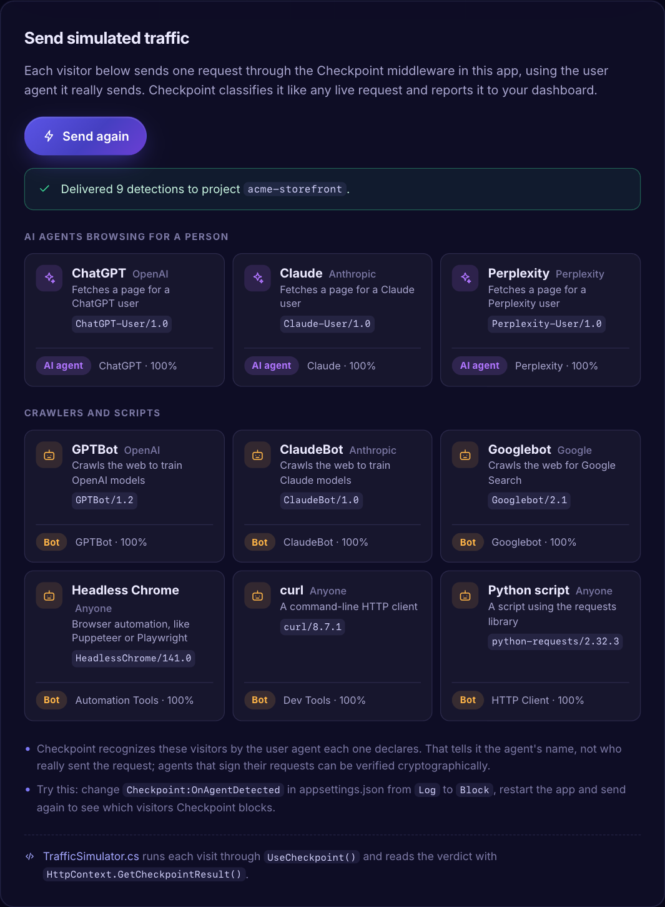

# Detecting AI Agents in ASP.NET Core with Checkpoint by Vouched

Are you wondering how many AI agents are visiting your website? [`KyaOs.Checkpoint`](https://www.nuget.org/packages/KyaOs.Checkpoint) makes it easy to find out!

AI agents like ChatGPT, Claude, Perplexity and Gemini are already browsing websites on behalf of real people. And unless we're looking for them, most of our websites can't tell the difference between a person, a crawler and an AI agent acting for a person.

In this post, we'll add Checkpoint Detect to an existing ASP.NET Core app in about 5 minutes, for free, and see exactly who (or what!) is visiting our site.

You're welcome to skip the definitions and jump directly to the code below.

## What is Know Your Agent (KYA)?

You've probably heard of KYC (Know Your Customer), the identity checks banks and fintech apps run to make sure we are who we say we are. [Know Your Agent](https://kya.vouched.id) (aka "KYA") is the same idea for the agent era: knowing which AI agents are interacting with our business, and which human authorized them.

[Vouched](https://www.vouched.id) helped author KYA-OS ("Know Your Agent - Operating System", pronounced "chaos" 😅), the open standard for AI agent identity and authorization, and donated it to the [Decentralized Identity Foundation](https://identity.foundation). Checkpoint is Vouched's product suite built on top of it.

## What is Checkpoint Detect?

[Checkpoint Detect](https://kya.vouched.id/docs/detect) identifies AI agents on our website in real time. It classifies every request as `human`, `ai_agent`, `bot` or `incomplete_data`, names the agent when it recognizes one, and assigns a confidence score from 0 to 100 that measures how strongly the evidence points to automation. For us ASP.NET Core developers, Detect ships as middleware in the `KyaOs.Checkpoint` NuGet package, which runs Vouched's Rust detection engine (compiled to WebAssembly) right inside our app. It runs in observe mode, so it never blocks anyone, and here's the best part: Detect is [free](https://kya.vouched.id/pricing). No credit card required!

## What about Enforce and Govern?

Once we know which agents are visiting, we'll naturally want to decide what each one is allowed to do. That's where Checkpoint's upgrades come in:

- **[Enforce](https://kya.vouched.id/docs/enforce)** applies policies to the agents Detect finds: allow, block, redirect or challenge them. We write the policies in plain language in the Checkpoint dashboard (they compile to [Cedar](https://kya.vouched.id/docs/enforce/policies)) and update them without redeploying our app.
- **[Govern](https://kya.vouched.id/docs/govern)** goes one step further: AI agents present cryptographic proof of who authorized them and what they're allowed to do, so a verified agent can safely check out on a customer's behalf.

Both are free to trial, and production-scale Enforce and Govern come with the [Enterprise plan](https://kya.vouched.id/pricing). We'll dig into each of them in future posts. Today, let's start with Detect!

## Code

Now that we have those pesky definitions out of the way, let's write some code!

You can find the completed code sample here: [https://github.com/TheCodeTraveler/KnowYourAgentWebsite-Dotnet-Blazor](https://github.com/TheCodeTraveler/KnowYourAgentWebsite-Dotnet-Blazor)



### Prerequisites

If you'd like to follow along, here are the steps.

- An existing ASP.NET Core app running on .NET 8, .NET 9 or .NET 10
  - Checkpoint also supports .NET Framework 4.6.2 through 4.8.1; see the [.NET integration guide](https://kya.vouched.id/docs/integrations/dotnet)
- A free Vouched account: [kya.vouched.id/signup](https://kya.vouched.id/signup)

Once you're signed in:

1. Create a new project for your website
2. Open **Installations**, then start the **Detect** setup
3. Copy the **Project ID** from the server snippet: it's the value assigned to `options.ProjectId`
4. Create an **API key** (it starts with `sk_`): ask the assistant on the dashboard's **Home** page for your project's credentials, or open your user menu and go to **All settings → API keys**

If you get stuck, Vouched's [Credentials docs](https://kya.vouched.id/docs/credentials) walk through exactly where to find both.

### 1. Add the NuGet Package

First, let's add the [`KyaOs.Checkpoint` NuGet Package](https://www.nuget.org/packages/KyaOs.Checkpoint) to our ASP.NET Core app:

```bash
dotnet add package KyaOs.Checkpoint
```

If you're unfamiliar with adding NuGet Packages, you can find more information [here](https://learn.microsoft.com/nuget/consume-packages/install-use-packages-visual-studio#find-and-install-a-package).

`KyaOs.Checkpoint` is a metapackage: NuGet automatically pulls in the correct adapter for our target framework, `Checkpoint.AspNetCore` for ASP.NET Core and `Checkpoint.AspNet` for .NET Framework.

### 2. Store our Keys (Safely!)

Before we write any code, let's talk about where our keys live. Our API key is a secret, and it should NEVER be committed to source control.

For local development, I HIGHLY recommend using [.NET User Secrets](https://learn.microsoft.com/aspnet/core/security/app-secrets). They're stored in our user profile, outside of our repository, so there's zero chance of accidentally pushing them to GitHub. Your future self will thank you! 💯

From the folder containing our app's `.csproj`, run:

```bash
dotnet user-secrets init
dotnet user-secrets set "Checkpoint:ProjectId" "<your project id>"
dotnet user-secrets set "Checkpoint:ApiKey" "<your api key>"
```

Not a fan of copy/pasting keys? Me neither! Vouched's [`kya-os` CLI](https://kya.vouched.id/docs/installation) can do this for us. From the same folder, run `kya-os login`, then `kya-os detect install --surface sdk --project <your project id>`. It creates a brand new API key and saves it, along with our Project ID, to User Secrets.

When we deploy our app, we'll set the same two values as environment variables (or in our host's secret store, like Azure Key Vault), using a double underscore in place of the colon:

```bash
Checkpoint__ProjectId=<your project id>
Checkpoint__ApiKey=<your api key>
```

ASP.NET Core's configuration system reads all of these automatically, so our code doesn't change between environments.

### 3. Add Checkpoint to Program.cs

Now we can finally write some code!

In `Program.cs`, let's register Checkpoint with `AddCheckpoint()` and add its middleware with `UseCheckpoint()`:

```csharp
using Checkpoint.AspNetCore.Extensions;
using Checkpoint.Core.Configuration;

var builder = WebApplication.CreateBuilder(args);

builder.Services.AddCheckpoint(options =>
{
    options.ProjectId = builder.Configuration["Checkpoint:ProjectId"];
    options.ApiKey = builder.Configuration["Checkpoint:ApiKey"];

    // Observe mode: classify and report every request, block nothing
    options.OnAgentDetected = DetectedAction.Log;
});

// ...the rest of our existing services

var app = builder.Build();

// Add Checkpoint before routing, authentication and authorization
app.UseCheckpoint();

// ...the rest of our existing middleware, like app.UseRouting() and app.UseAuthorization()
// ...and our existing endpoints

app.Run();
```

That's it! Two lines of code. 🎉

A couple of things worth pointing out:

- **`UseCheckpoint()` goes before `UseRouting()`, `UseAuthentication()` and `UseAuthorization()`.** This lets Checkpoint classify every request before the rest of our pipeline runs.
- **`DetectedAction.Log` is observe mode.** It's already the default, but I like being explicit about it so the next developer who reads our code knows we're intentionally not blocking anything (yet!).

What if we forget to add our keys? Don't worry, our app still starts! Checkpoint runs in *local detection-only mode*: every request is still classified on our machine, but nothing is reported to our dashboard. It also logs a helpful warning at startup:

```text
warn: Checkpoint.Configuration[0]
      Checkpoint is running in local detection-only mode: ProjectId and ApiKey are not set. Detection and the OnAgentDetected action run locally, but no dashboard policy applies and no detections reach the dashboard. Set both to connect this app to its Checkpoint project.
```

### 4. Click Run

Now let's click Run and see what happens 👀

Our website looks exactly the same in the browser. That's the point! Observe mode doesn't change anything for our visitors.

To see Checkpoint in action, let's pretend to be an AI agent. Open a terminal and send a request using ChatGPT's user agent:

```bash
curl -I -A "Mozilla/5.0 AppleWebKit/537.36 (KHTML, like Gecko); compatible; ChatGPT-User/1.0; +https://openai.com/bot" https://localhost:7273/
```

Checkpoint adds its verdict to every response as `KYA-*` headers:

```text
HTTP/1.1 200 OK
KYA-Detected: true
KYA-Confidence: 100
KYA-Class: AiAgent
KYA-Agent: ChatGPT
KYA-Verification: Pattern
KYA-Session: b0506919ccc082f2
```

And our app's logs show it too:

```text
info: Checkpoint.AspNetCore.Middleware.CheckpointMiddleware[0]
      AI agent detected: ChatGPT (confidence: 99.99999999993561%, path: /, verification: Pattern)
```

It works! Checkpoint correctly identified ChatGPT as an AI agent, and it only took two lines of code!

Let's try OpenAI's GPTBot crawler next by swapping in its user agent: `Mozilla/5.0 AppleWebKit/537.36 (KHTML, like Gecko; compatible; GPTBot/1.2; +https://openai.com/gptbot)`. Notice that this time Checkpoint returns `KYA-Class: Bot` instead of `AiAgent`. That's an important distinction: GPTBot is a crawler collecting training data, while ChatGPT-User is an AI assistant browsing on behalf of a real person.

Now open the [Checkpoint dashboard](https://kya.vouched.id/dashboard), make sure the project we created is selected, and go to **Detect → Activity**. Within a minute, we'll see both requests show up, labeled ChatGPT and GPTBot. 🎉

### 5. Read the Verdict in Code

Logging is great, but the real power comes from using the verdict in our own code. Checkpoint attaches its result to every request, and we can read it anywhere we have an `HttpContext` using `GetCheckpointResult()`.

Let's add a quick Minimal API endpoint that tells each visitor how Checkpoint classified them:

```csharp
using Checkpoint.AspNetCore;

app.MapGet("/whoami", (HttpContext context) =>
{
    // Paths in Checkpoint's SkipPaths return a placeholder result, so check this first
    if (context.WasCheckpointSkipped())
        return Results.Ok(new { verdict = "not analyzed" });

    var result = context.GetCheckpointResult();

    return Results.Ok(new
    {
        verdict = result?.DetectionClass.Type.ToString(),
        isAgent = result?.IsAgent,
        agent = result?.DetectedAgent?.Name,
        confidence = result?.Confidence,
    });
});
```

The same `GetCheckpointResult()` extension method works in MVC Controllers, Razor Pages and statically rendered Blazor components (via the cascading `HttpContext`). This is exactly how the sample app reads the verdict for each simulated visitor!

## Bonus: Unit Testing Checkpoint

Here's a fun one: because Checkpoint's detection engine runs inside our app, we can write unit tests that send real requests through it using [`WebApplicationFactory`](https://learn.microsoft.com/aspnet/core/test/integration-tests), with no API key and no network required.

The sample repo includes a suite of [NUnit tests](https://github.com/TheCodeTraveler/KnowYourAgentWebsite-Dotnet-Blazor/tree/main/tests/KnowYourAgentWebsite.Tests) that verify how ChatGPT, GPTBot, ClaudeBot, Googlebot, curl and a real Chrome browser are each classified. I recommend copying this pattern into your own app. That way, whenever Dependabot proposes a `KyaOs.Checkpoint` update that changes how our traffic is classified, our CI pipeline tells us before our users notice!

## Conclusion

As .NET developers, we can no longer assume that every visitor to our website is a person. AI agents are already here, and thanks to `KyaOs.Checkpoint`, it only takes two lines of code (and zero dollars) to start seeing them.

And we've only scratched the surface! Checkpoint can also verify agents that cryptographically sign their requests, apply policies from our dashboard with [Enforce](https://kya.vouched.id/docs/enforce), and let verified agents act on a customer's behalf with [Govern](https://kya.vouched.id/docs/govern).

You can find the completed code sample here: [https://github.com/TheCodeTraveler/KnowYourAgentWebsite-Dotnet-Blazor](https://github.com/TheCodeTraveler/KnowYourAgentWebsite-Dotnet-Blazor)

The sample is a small, open-source ASP.NET Core app that does everything in this post, plus one fun extra. Paste your Project ID and API key into the page and it saves them to User Secrets for you. Then click **Send simulated traffic** to run ChatGPT, Claude, Perplexity, GPTBot, Googlebot, curl and more through Checkpoint, and watch them all arrive in your dashboard! Only have a Project ID handy? That works too: the Checkpoint pixel reports your own visits to the sample with just the Project ID.

Next, we'll move from observing to enforcing: blocking and challenging AI agents with Checkpoint Enforce. Make sure to subscribe to this blog so you don't miss it! 👇
